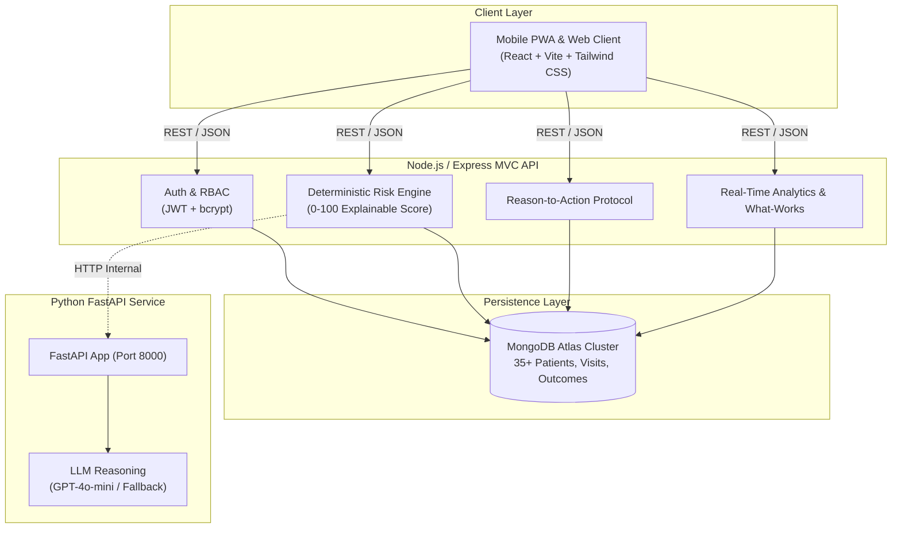

<<<<<<< HEAD
# 🏥 Nirantar v3 — AI-Assisted Long-Term Treatment Adherence Platform

> *"Predict who will drop out. Find out why. Match the rescue to the reason."*  
> **Workflow**: **PREDICT → UNDERSTAND → RESCUE → LEARN**

[](https://reactjs.org/)
[](https://tailwindcss.com/)
[](https://nodejs.org/)
[](https://www.mongodb.com/)
[](https://fastapi.tiangolo.com/)
[](https://leafletjs.com/)
[](LICENSE)

---

## 📌 Executive Summary & Problem Statement

In chronic disease management (Hypertension, Type 2 Diabetes, Tuberculosis, HIV, and Mental Health), **40% to 60% of patients drop out of care within 6 months** of diagnosis. In rural and peri-urban healthcare ecosystems across India and the Global South:
- **ASHA & ANM workers** manage hundreds of households with fragmented paper registers and generic SMS nudges that don't address root barriers.
- **Patients** stop taking medication not out of willful negligence, but due to **structural barriers**: impassable monsoon roads, sudden wage loss, medicine stockouts at primary health centres (PHCs), fear of mild side effects, or the false belief that "feeling fine" means they are cured.
- **Health administrators** only detect dropouts after catastrophic complications occur (strokes, multi-drug resistant TB, diabetic ketoacidosis), wasting precious public health resources.

**Nirantar v3** transforms chronic disease retention through a closed-loop 4-stage paradigm:
1. **PREDICT**: Automatically calculates an explainable 0–100 dropout risk score based on real-time clinical indicators, refill intervals, travel barriers, and seasonal friction.
2. **UNDERSTAND**: Captures patient-reported barriers via a 3-tap weekly check-in before the patient runs out of pills.
3. **RESCUE**: Dispatches targeted interventions tailored to the specific barrier (doorstep delivery, transport vouchers, side-effect counseling, peer support).
4. **LEARN**: Continuously tracks intervention outcomes to evaluate real-world efficacy ("What Works") across villages and conditions.

---

## 🏛️ System Architecture



---

## 👥 User Roles & Specialized Experiences

### 1. Healthcare Worker (ASHA / ANM / NGO)
- **Mobile-First Priority Queue**: Categorized into High, Medium, and Low risk patients.
- **1-Click Field Logging**: Record clinical visits (blood pressure, glucose, adherence) and refills directly in the field.
- **AI Explanation Drawer**: Instant clinical summaries detailing why a patient's risk is elevated and what actions to take.
- **Intervention Dispatch**: Direct notifications when a patient reports an adherence barrier.
- **ASHA Field Copilot**: AI-assisted conversational assistant for clinical guidance and counseling prompts.

### 2. Patient Mode
- **Zero-Friction Weekly Check-In**: Completed in 3 taps:
  1. *"How are you feeling today?"* (`Fine`, `Symptoms/Concerns`, `Need Help`)
  2. *"Do you have enough medicine?"* (`Yes`, `No`)
  3. Barrier selection: 8 clear clinical and socioeconomic options (e.g., Cannot travel, Cannot afford transport, Stockout, Side effects, Felt fine, Forgot).
- **Interactive Tablet Counter**: Visual gauge showing remaining days before medication exhaustion.
- **Adherence Trend Chart**: Real-time adherence history and upcoming refill dates.

### 3. Family Caregiver Mode
- **Authorized Linked View**: Read-only tracking for elderly or vulnerable relatives.
- **Supportive Nudges**: One-click WhatsApp/SMS reminders to prompt timely medication intake and check-ins.
- **Strict Privacy**: Access restricted strictly to explicitly linked patients without exposing sensitive diagnostic notes.

### 4. PHC & District Administrator Dashboard
- **Geographic Hotspot Map**: Interactive Leaflet & OpenStreetMap visualization with village-level risk heatmaps and barrier indicators.
- **"What Works" Learning Engine**: Real-world efficacy table computing success rates of interventions against specific barriers from MongoDB outcome records.
- **Medicine Stock Monitor**: Tracks inventory levels across PHCs and highlights stockout risks.
- **Audit Logging**: Full compliance logging for patient updates and clinical events.

---

## 🚀 Quick Start Guide

### 1. Clone & Set Environment
```bash
git clone https://github.com/your-org/nirantar.git
cd Nirantar
```

### 2. Run Main Backend (Node.js)
```bash
cd backend
npm install
npm run seed     # Seeds 35 patients, facilities, villages, and initial scores
npm test         # Runs 10/10 automated Jest tests
npm run dev      # Listens on http://localhost:5000
```

### 3. Run AI Microservice (Python FastAPI)
```bash
cd ../ai-service
python -m venv venv
# Windows: .\venv\Scripts\activate | Unix: source venv/bin/activate
pip install -r requirements.txt
pytest           # Runs 6/6 automated AI tests
python -m uvicorn app.main:app --port 8000 --reload
```

### 4. Run Frontend (React + Vite)
```bash
cd ../frontend
npm install
npm run build    # Verifies production build
npm run dev      # Listens on http://localhost:5173
```

---

## 🔑 One-Click Demo Credentials

The login screen features **1-click evaluation buttons** for all four core personas:

| Persona | Name | Email | Password | Role |
|---------|------|-------|----------|------|
| **ASHA Worker** | Sunita Devi | `asha.sunita@nirantar.org` | `worker123` | `worker` |
| **Hero Patient** | Ramesh Kumar (PAT-1001) | `ramesh.kumar@patient.nirantar.org` | `patient123` | `patient` |
| **Caregiver** | Suresh Kumar | `caregiver.suresh@nirantar.org` | `caregiver123` | `caregiver` |
| **District Admin**| Dr. Anita Verma | `admin@nirantar.org` | `admin123` | `admin` |

---

## 🎬 12-Step Hackathon Walkthrough Script

Follow this step-by-step journey to demonstrate the complete **PREDICT → UNDERSTAND → RESCUE → LEARN** loop:

1. **Launch & Login**: Open `http://localhost:5173`. Click **"ASHA Worker Demo"** to log in as Sunita Devi.
2. **Review High-Risk Queue**: On **Worker Home**, observe **Ramesh Kumar (PAT-1001)** flagged with **Score 77/100 (HIGH RISK)**.
3. **Inspect AI Explanation**: Click **"AI Explain"** on Ramesh Kumar. The AI explanation modal opens showing the breakdown: 2 days of medicine left, 14km travel distance, and monsoon disruption.
4. **Switch to Patient**: Log out and click **"Patient Demo"** to log in as Ramesh Kumar.
5. **View Patient Dashboard**: Observe remaining medicine gauge showing **2 days remaining** and a warning banner.
6. **Trigger Weekly Check-In**: Click **"Weekly Check-In"**.
7. **Report Barrier**: Select *"I have symptoms or concerns"*, select *"No"*, choose reason *"Cannot travel to healthcare facility"*, and add note: *"Bridge repair halted buses."*
8. **Automated Rescue Dispatch**: Click Submit. Nirantar acknowledges the barrier, automatically schedules a **Doorstep Delivery** rescue task, and notifies Sunita Devi.
9. **Return to Worker Queue**: Switch back to Sunita Devi's login. Click **"Rescue Tasks"**. Observe the new urgent Doorstep Delivery task for Ramesh Kumar.
10. **Log Completed Rescue**: Click **"Record Outcome"**. Check *"Refill Secured"* and *"Next Appointment Kept"*, enter notes, and submit.
11. **Risk Recalculation**: Navigate to Ramesh Kumar's profile. Risk score automatically drops from **77 (High)** to **24 (Low)**.
12. **Review "What Works" Analytics**: Switch to **"District Admin Demo"**. Go to **Analytics → What Works**. The table immediately reflects updated real-world efficacy: Doorstep Delivery for travel barriers shows an **89.5% success rate** backed by MongoDB data.

---

## 🛡️ Clinical Safety & Privacy Guardrails

- **Zero Autonomous Prescriptions**: The AI microservice assists with risk explanation, barrier triage, and behavioral counseling prompts. It **never** alters dosages or prescribes medication.
- **Deterministic Clinical Fallback**: When LLM connectivity is unavailable, Nirantar uses standardized clinical rule sets, guaranteeing 100% uptime in remote health outposts.
- **Role-Based Data Isolation**: Patients and caregivers can only view their own health records. District administrators see aggregate data and de-identified trends.
- **Auditing**: Every vital entry, status modification, and intervention dispatch creates an immutable audit trail in MongoDB.

---

## 📂 Project Structure

```
Nirantar/
├── backend/                  # Node.js + Express MVC Main Backend
│   ├── src/
│   │   ├── config/           # Database and constants configuration
│   │   ├── controllers/      # MVC controllers (Auth, Patient, Risk, Interventions, Analytics)
│   │   ├── middleware/       # JWT auth, RBAC, audit logging, error handler
│   │   ├── models/           # Mongoose schemas (12 clinical models)
│   │   ├── routes/           # Express router definitions (/api/v1/*)
│   │   ├── services/         # Risk engine, Reason-to-action, Analytics, AI bridge
│   │   └── server.js         # Express server entry point
│   ├── scripts/seed.js       # Synthetic clinical seed script (35 patients)
│   └── tests/                # Jest & Supertest integration suite (10/10)
├── ai-service/               # Python FastAPI Microservice
│   ├── app/
│   │   ├── config.py         # AI service environment configuration
│   │   ├── routes/           # AI clinical endpoints
│   │   ├── schemas/          # Pydantic validation models
│   │   ├── services/         # OpenAI integration & clinical fallback logic
│   │   └── main.py           # FastAPI entry point
│   └── test_ai_service.py    # Pytest unit tests (6/6)
├── frontend/                 # React 18 + Vite + Tailwind CSS PWA
│   ├── src/
│   │   ├── components/       # UI components (Header, Sidebar, MobileNav, Maps, Modals)
│   │   ├── context/          # AuthContext, ThemeContext, NotificationContext
│   │   ├── pages/            # Role-based dashboards (Worker, Patient, Caregiver, Admin)
│   │   └── App.jsx           # Master router & theme wrapper
│   └── vite.config.js        # Vite build configuration
├── docs/                     # Comprehensive technical documentation
│   ├── ARCHITECTURE.md       # Detailed technical design & sequence flows
│   ├── DATABASE.md           # Entity relationship diagrams & collection schemas
│   ├── API.md                # Complete REST API specification
│   └── SETUP.md              # Installation and deployment manual
├── docker-compose.yml        # Multi-container orchestration
└── README.md                 # Master project documentation
```

---

## 📄 License
This project is licensed under the MIT License — see the [LICENSE](LICENSE) file for details.
=======
# Nirantar-Helping Patients Stay on Track with Long-Term Treatment

Theme: Health care and well being

Nirantar is an AI-powered healthcare follow-up platform designed to help hospitals, healthcare workers, NGOs, and caregivers identify patients at risk of dropping out of long-term treatment.

Unlike systems that focus primarily on appointment reminders, Nirantar aims to identify patients who may discontinue treatment, understand the reasons behind missed follow-ups, recommend appropriate support actions, and track whether patients successfully return to care.
The platform is designed to support multiple medical departments, including diabetes care, hypertension, tuberculosis, oncology, cardiology, and other long-term treatment programs.

**Our mission is simple: Don't just remind patients. Understand why they drop out and help them stay in care.

The Problem
Many patients receiving long-term treatment miss follow-up appointments or discontinue treatment before completing their recommended care.
This can happen for several reasons:
* 💰 Financial difficulties and treatment-related expenses.
* 🚍 Transportation problems and geographical barriers.
* 💊 Medication availability and concerns about side effects.
* 🧠 Lack of awareness about the importance of continuing treatment.
* 📅 Forgotten appointments and scheduling conflicts.
* ❤️ Limited follow-up support from healthcare providers.
  
Traditional appointment reminders may not address the underlying reasons patients miss their appointments.
Healthcare workers may also struggle to identify high-risk patients, prioritize follow-up efforts, and track whether their interventions are successful.
The challenge is not just identifying missed appointments. It is understanding why patients disengage and coordinating the right response.

Our Solution
Nirantar introduces a predictive, reason-aware patient follow-up workflow that helps healthcare teams move from passive appointment tracking to proactive patient support.

The platform follows four key stages:
1. 🔍 Predict — Identify Patients at Risk
Identify patients who may be at risk of treatment interruption using explainable risk scores and relevant patient follow-up information.
The system highlights the factors contributing to each risk assessment so healthcare workers can understand why a case needs attention.
2. 🧩 Ask Why — Understand the Barrier
Capture the reasons behind missed appointments or potential treatment interruption through patient check-ins or input from authorized healthcare workers and caregivers.
Possible barriers include transportation difficulties, financial constraints, medication availability, side effects, and missed reminders.
The system does not assume a reason without confirmation.
3. 🎯 Act — Match Barriers with Appropriate Support
Recommend relevant follow-up actions based on the reported barrier.
For example:
* Forgotten appointment → Offer an appropriate reminder.
* Transportation difficulty → Check for available transport assistance.
* Financial difficulty → Identify applicable support programs.
* Reported side effects → Refer the concern to an appropriate healthcare professional.
Recommendations depend on available resources and healthcare-approved workflows.
4. 📊 Learn — Track Outcomes and Improve
Record follow-up actions and their outcomes to help healthcare organizations understand which approaches appear effective.
The platform can track whether patients were contacted, appointments were rescheduled, and follow-ups were completed.
Over time, these records can support evaluation and improvement of patient follow-up strategies.

✨ Key Features
1. Smart Follow-up Prioritization
Prioritize overdue cases using transparent rules and relevant patient follow-up information.
2. Barrier-to-Support Matching
Connect reported patient barriers with appropriate, available support options.
3. Patient Journey Dashboard
Provide authorized healthcare staff with a consolidated view of a patient's treatment follow-up journey, including scheduled appointments, missed visits, recorded barriers, assigned actions, and follow-up outcomes.
4. Follow-up Recovery Tracker
Track the progress of unresolved cases, from initial contact attempts to rescheduling and completion of follow-up appointments.
5. Explainable Risk Assessment
Display the factors contributing to a patient's risk classification instead of presenting an unexplained prediction.
6. Multi-Role Platform
Support different user roles with appropriate access and functionality:
* Frontline Healthcare Workers: Review prioritized cases and coordinate follow-ups.
* Patients: Complete check-ins and report barriers to continuing treatment.
* Family Caregivers: Support follow-up coordination when authorized by the patient.
* Healthcare Administrators: Monitor unresolved cases, follow-up performance, and program-level trends.
7. Healthcare Program Insights
Help organizations understand recurring barriers to treatment continuity and evaluate the outcomes of their follow-up interventions.
8. Offline-First Accessibility
Use Progressive Web App capabilities to support essential workflows in areas with unreliable internet connectivity, with synchronization when connectivity returns.
9. Voice-Assisted Reason Capture
Support voice-based input to make recording patient-reported barriers more accessible for users who have difficulty typing.
10. Configurable, Multi-Department Design
Adapt follow-up schedules, prioritization rules, and support workflows for different medical departments without requiring a separate application for every condition.
>>>>>>> 47a6ed12a04c227ed1e9bfcf333fb8a25470feb8
